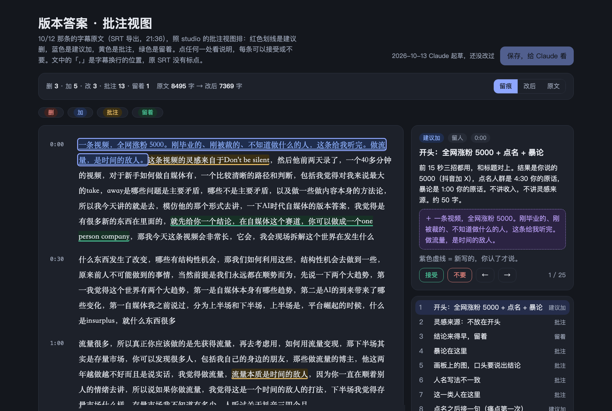
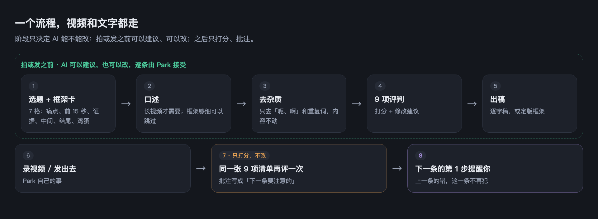
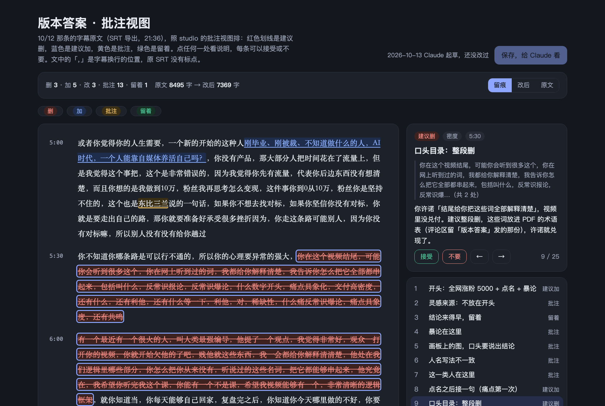
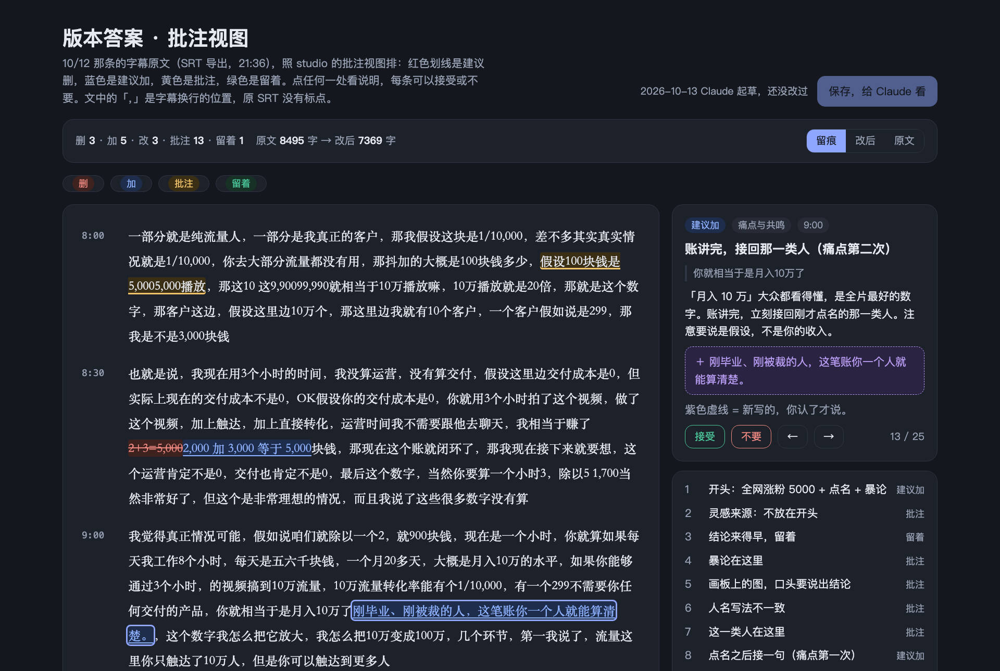
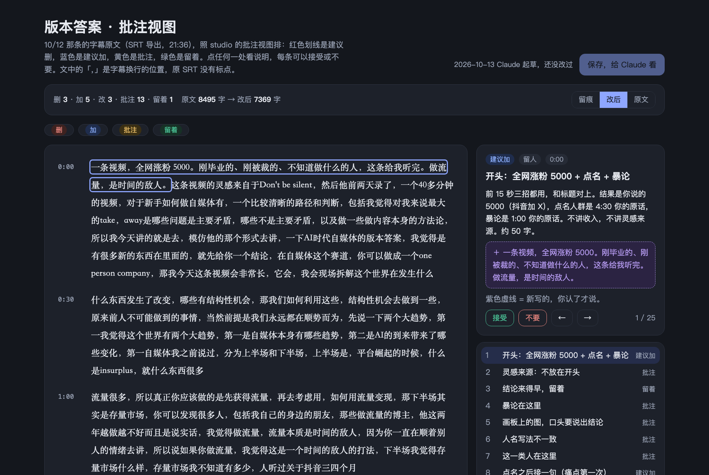
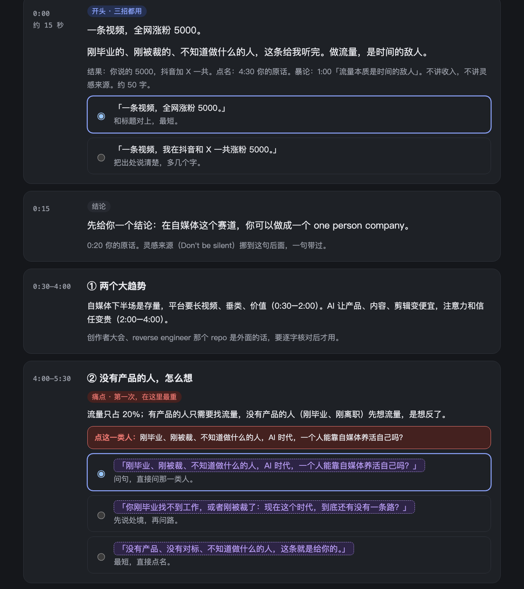
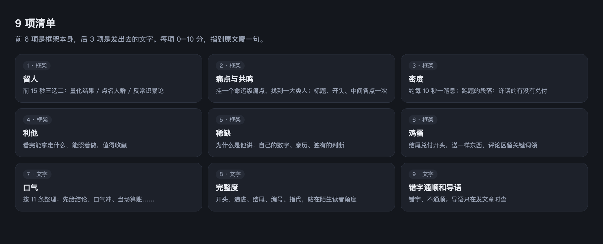

<div align="center">

# park-writing

**一个流程、一张 9 项清单：先把框架想清楚再拍，拍完只批注，下一条不再犯同样的错**

[](https://docs.anthropic.com/en/docs/claude-code)
[](https://github.com/openai/codex)
[](references)
[](https://github.com/zinan92/park-writing/actions/workflows/test.yml)
[](#功能一览)

</div>

---

<p align="center"></p>
<p align="center"><sub>一条已经录完的视频（21 分钟，约 8500 字）按这套框架打分、批注。红色划线 = 建议删，蓝色 = 建议加，黄色 = 批注，绿色 = 留着；右边点哪一处，就说明那一处为什么。</sub></p>

```
in   Park 自己的内容：选题 + 口述 | SRT 转写 | 笔记 | 草稿
out  框架卡（7 格）+ 去杂质后的稿 + 9 项评分和修改建议 + 逐字稿 | 定版框架
     拍或发之后：同一张 9 项清单的打分和批注，变成「下一条要注意的」

fail 材料不是 Park 自己的       → 不处理，不改写别人的内容
fail 原文缺证据 / 数字 / 经历   → 标出「这里缺……」，不编，让他自己补
fail 要删他的内容（超过口水）   → 不做；改完字数要在原文九成以上
fail 拍或发之后                 → 只打分批注，不改稿，也不让他补拍
fail 清单指向的标题被改名或删掉 → 工作台拒绝运行那一步，测试先在这里挡住
```

它只处理 Park 自己说过、写过的话：**挪、放大、标出来，不换词、不加料**。

**不想自己装**：这套写法已经接进 [选题工作台](https://xuanti.park-ai-intel.com/) 的「写」，网页上直接用，免费试用 7 天。

## 示例输出

下面全是同一条视频的真实输出：2026-10-12 录完的《AI 时代自媒体博主的版本答案》。字幕是剪映导出的 SRT，一个字没动。

### 一个流程，视频和文字都走

<p align="center"></p>

阶段只决定 AI 能不能改：拍或发之前可以建议、可以改，逐条由 Park 接受；拍或发之后只打分、批注。拍之后不改，是因为不想再拿起摄像头补拍，所以力气花在拍之前：框架清楚，录完就不会有大出入。

### 批注：这条视频哪里该删、哪里该加

| | |
|---|---|
|  |  |
| 5:30 说「结尾给你把这些词全部解释清楚」，视频里没兑付。建议整段删，改放进送出去的 PDF 里，许诺就兑现了。 | 算完账，立刻接回刚才点名的那一类人。紫色虚线是新写的一句，Park 认了才说。 |

<details><summary>「改后」视图：接受全部建议以后的稿子</summary>
<p align="center"></p>
</details>

### 重拍之前先出框架卡

<p align="center"></p>

按拍摄顺序排好：前 15 秒、结论、中间每一段（每段标着原话在 10/12 视频里的时间点）、点到那一类人的地方（红色）。新写的句子用紫色虚线标出，Park 认了才说；数字只用他自己说过的。

### 9 项清单

<p align="center"></p>

这条 10/12 视频的分数：留人 2、痛点与共鸣 4、密度 6、利他 6、稀缺 6、鸡蛋 2、口气 8、完整度 5、错字通顺和导语 6（导语不适用）。每一项都指到原文哪一句。

> 截图里是 Park 本人的真实内容。仓库现在是私有的；开源前要换成示例稿，或者征得他同意再放。

## 架构

```
 Claude Code / Codex                      content-studio（工作台）
        │  读 SKILL.md                            │  读 module.yaml
        ▼                                         ▼
┌───────────────────────────────────────────────────────────────┐
│ park-writing                                                  │
│                                                               │
│  SKILL.md ──── 入口：三条硬规矩 · 每种形态走哪几步 · 11 点整理 │
│  module.yaml ─ 清单：2 个出厂流程 · 10 步 · 每步读哪一段       │
│  references/ ─ 每一步的细则                                    │
│     视频框架 · 开头 · 骨架 · 密度 · 共鸣与稀缺 · QA · 配图 · X短帖│
│  tests/ ────── 清单自洽：流程里的步骤、每一步指到的标题都在    │
└───────────────────────────────────────────────────────────────┘
        │                                         │
        ▼                                         ▼
  按步骤在终端里单独跑                   每一步变成一个按钮，每篇留一条记录
  「按 park-writing 的 opening 改这篇」   （规则只在这里，工作台里没有第二份）
```

## 快速开始

```bash
# 1. 克隆
git clone https://github.com/zinan92/park-writing.git ~/work/park-writing

# 2. 装成 skill（Claude Code；Codex 同理换成 ~/.codex/skills）
ln -sfn ~/work/park-writing ~/.claude/skills/park-writing

# 3. 验证：清单自洽
cd ~/work/park-writing
pip install -r requirements-dev.txt
python3 -m pytest -q          # 6 passed
```

然后在 Claude Code 里说：

- 「按 park-writing 给 `10月12日.srt` 打 9 项分，只批注，不改」
- 「用 park-writing 给这个选题出框架卡」
- 「按 park-writing 的 opening 这一步改这篇」

工作台（content-studio）按 `~/.claude/skills`、`~/.codex/skills`、`~/.agents/skills` 的顺序找 `park-writing`，也可以用环境变量 `CONTENT_STUDIO_WRITING_SKILL` 指定。

## 框架的几个关键规矩

**前 15 秒：三招里至少用两招。** 量化的、大众看得懂的结果；点名人群；反常识暴论。有结果就放第一句；结果不是观点；数字只能是自己说过的。

**命运级痛点：每条都要挂一个。** 找工作、婚恋婚嫁、出国留学、孩子升学、养老、做生意 / 赚钱、买房、看病 / 健康、被 AI 取代 / 中年失业。共鸣就是找到处在这个痛点上的一大类人，不是找一个话题；标题、开头、正文中间各点一次。

**结尾送鸡蛋：每条都送。** 按用户要花的力气排：RSS feed、能聊天的 Agent、PDF、提示词、GitHub repo。PDF 和提示词兜底，每条视频都做得出来。评论区留关键词领。

**三条硬规矩（每一步都适用）：** 不删内容；用他的原词；不加料。

## 功能一览

| 功能 | 说明 | 状态 |
|------|------|------|
| 第 4 步整理（11 点） | 先给结论、口气冲、自己的数字、当场算账……只挪不换词 | 已完成，在跑 |
| 流程 1 / 流程 2 | 出厂的两个默认流程，每步可开关，顺序固定 | 已完成，工作台在读 |
| 发前 QA | 完整度五项、价值、错字通顺和导语 | 已完成，在跑 |
| 视频框架卡（7 格） | 拍之前先定框架：痛点、前 15 秒、证据、中间、结尾、鸡蛋 | 线下试跑中 |
| 9 项评判 | 视频和文字同一张清单 | 线下试跑中；工作台里还是旧的 10 步 |
| 拍后只批注 | 拍或发之后不改稿，批注写成「下一条要注意的」 | 线下试跑中；工作台的「润色」还会在录完的转写上提修改，待改 |
| 规则和检查脚本全部放进这里 | 工作台只管流程和界面 | 计划中 |
| 开源 | 方法层公开，Park 自己的口气和数据留私有 | 计划中 |

## 给 AI Agent

### Capability Contract

```yaml
name: park-writing
version: 1
type: agent-skill
capability:
  summary: "Turn Park's own spoken or written material into a complete video script or article, and score finished content against one nine-item checklist."
  in: "Park's own content: topic + dictation | SRT transcript | notes | draft"
  out: "framework card + de-noised text + nine-item score with edit suggestions + verbatim script | final framework; after shooting or publishing: score and annotations only"
  fail:
    - "material is not Park's own -> refuse to rewrite"
    - "source lacks evidence, numbers or experience -> flag the gap, never invent"
    - "edit would delete more than filler words -> not done; result must stay above 90% of the original"
    - "content already shot or published -> score and annotate only, no edits"
    - "module.yaml points to a missing heading -> the host refuses to run that step; tests catch it first"
entrypoints:
  skill: SKILL.md
  manifest: module.yaml
  video_framework: references/视频框架.md
install_command: "ln -sfn ~/work/park-writing ~/.claude/skills/park-writing"
test_command: "python3 -m pytest -q"
```

### Agent 调用示例

不是 HTTP 服务，没有端口。用 Claude Code 的非交互模式调用：

```python
import subprocess

# 拍完以后：只打分批注，不改稿
result = subprocess.run(
    ["claude", "-p",
     "按 park-writing 的视频框架，给 ./10月12日.srt 按 9 项清单打分，只批注，不改稿"],
    capture_output=True, text=True,
)
print(result.stdout)
```

按步骤单独跑：「按 park-writing 的 opening 这一步改这篇」，和工作台里那个按钮是同一件事（`module.yaml` 里 `steps.opening`）。

## 相关项目

| 项目 | 说明 | 链接 |
|------|------|------|
| content-studio | 内容工作台：读 `module.yaml`，把每一步变成按钮，每篇文章留运行记录（私有） | [zinan92/content-studio](https://github.com/zinan92/content-studio) |
| park-operating-system | Park 是谁、怎么判断、怎么干活的唯一正本；park-writing 原来放在它的 `skills/` 里，2026-10-13 搬出（私有） | [zinan92/park-operating-system](https://github.com/zinan92/park-operating-system) |

## 改

一件事一个 PR 进 `main`；`python3 -m pytest -q` 要过。持久的决定记进 [decision-log.md](decision-log.md)；怎么改清单见 [MODULE.md](MODULE.md)。

## License

尚未选定。仓库现在是私有的，开源前再定。
